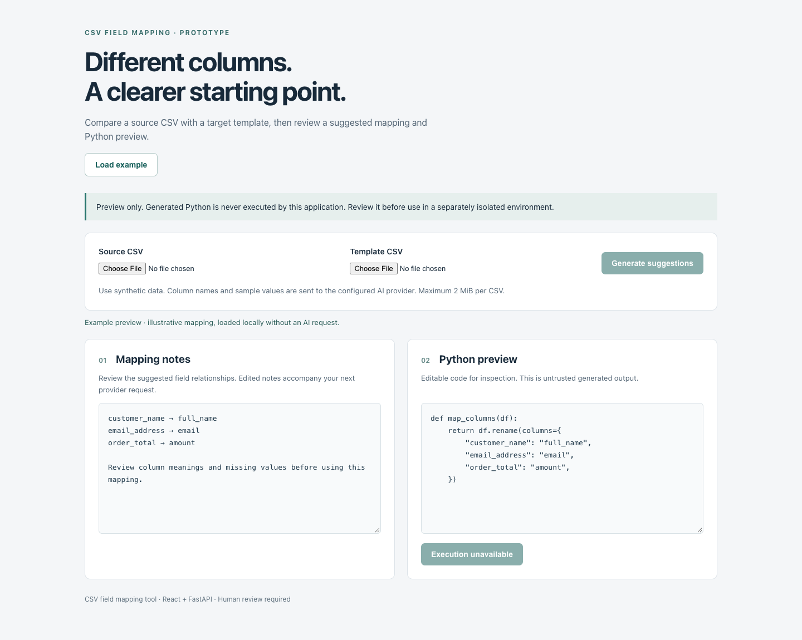

# CSV field mapping tool

A React and FastAPI prototype for comparing source CSV columns with a target template. An AI provider proposes mapping notes and Python code for a person to inspect. The application does **not** execute generated Python or produce a transformed CSV.



## Try the interface

```sh
cd front_end
npm ci --ignore-scripts
npm start
```

Open http://localhost:3000 and choose **Load example**. This uses an illustrative mapping entirely in the browser; it needs neither an API key nor a running backend. Both preview panels are editable. Selecting two CSVs enables a provider request.

## Connect the suggestion API

Use a separate Python environment and install `backend/requirements.txt`. These are the project's original dependency pins; the live provider integration has not been revalidated against today's provider services.

```sh
python -m venv .venv
source .venv/bin/activate
pip install -r backend/requirements.txt
cp backend/.env.example backend/.env
# Set OPENAI_API_KEY locally; never commit it.
cd backend
uvicorn main:app --host 127.0.0.1 --port 8000
```

The client defaults to http://localhost:8000. Set `REACT_APP_API_BASE_URL` before starting/building React to change it. Backend CORS allows localhost:3000.

| Endpoint | Behavior |
| --- | --- |
| `GET /` | Reports service capabilities; code execution is disabled. |
| `POST /suggest_column_mapping/` | Multipart `input_table`, `template_table`, and optional `suggestion`; returns mapping notes and code. |
| `POST /column_mapper/` | Always returns 503. The former in-process Python executor has been retired. |

CSV uploads must have a `.csv` extension, use UTF-8, and be at most 2 MiB each. Column names and sampled cell values are sent to the configured AI provider. The legacy suggestion layer also caches prompts/responses in local SQLite. Use synthetic data only; this demo has no authentication or tenant isolation. Runtime databases and environment files are ignored. The old tracked cache was removed from the current tree; earlier Git history can still contain it.

## Why stop at a preview?

Executing uploaded or model-generated Python inside the API process gives it access to that process's files, credentials, and network. The legacy runner now raises an explicit exception, and its HTTP route is unavailable. A future execution feature would need a separately isolated service with strict resource and access controls. Editing text in this UI does not make it safe to execute.

The model can misunderstand columns or produce invalid code. Notes are suggestions, not a validated schema conversion. No accuracy or fine-tuning result is claimed.

## Verification

Boundary tests need only the lightweight API dependencies, not the LLM stack:

```sh
pip install -r backend/requirements-test.txt
cd backend
python -m unittest test_safety -v
```

They check that both former execution entry points cannot write a file, that the API starts without provider credentials, and that missing credentials produce an explicit service error. Frontend tests cover the offline example, disabled execution, file prerequisites, and visible provider errors:

```sh
cd front_end
CI=true npm test -- --watchAll=false --runInBand
npm run build
```

The historical `screen shoots/` assets document the earlier interface. They do not represent the current preview-only behavior.

The Compose file builds these local sources rather than pulling the former private registry images. After configuring `backend/.env`, `docker compose up --build` exposes the UI at localhost:3000 and API at localhost:8000. Container builds were not exercised in this review.
