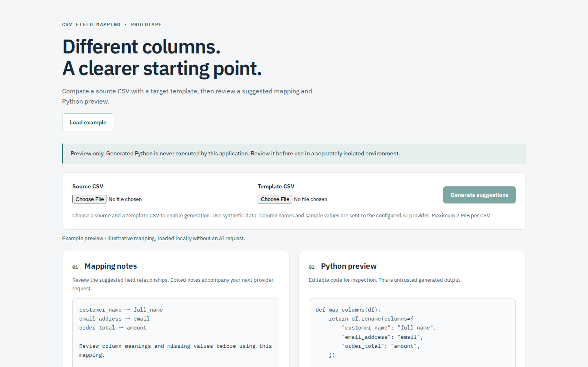
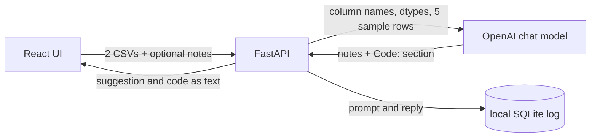
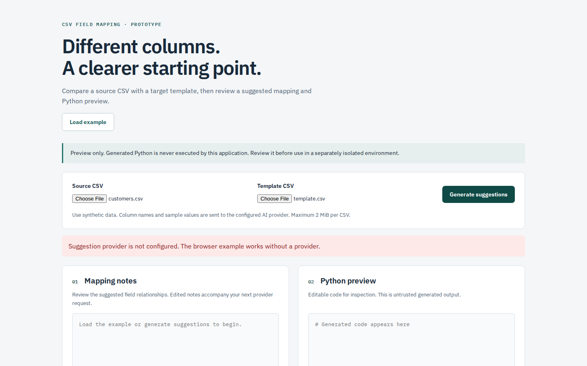
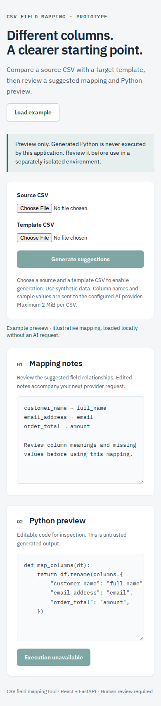

# CSV field mapping tool

A React and FastAPI prototype for lining up the columns of a source CSV with a target template. A language model looks at the column names, types and a few sample rows of both files and proposes mapping notes plus a Python `map_columns` function. A person reads and edits both. **The application never executes the generated Python** and does not produce a transformed CSV.



## What it does

- Upload a source CSV and a template CSV (UTF-8, `.csv`, up to 2 MiB each).
- Get mapping notes and a Python preview back from the configured OpenAI model.
- Edit the notes and ask again; the edited notes (minus the model's old rationale) steer the next suggestion.
- Try it without any key: **Load example** (or open `/?demo=1`) fills both panels with an illustrative mapping entirely in the browser.



## Run it

### Docker Compose

```sh
docker compose up --build
```

Open http://localhost:3000 and choose **Load example**. Without a key the API answers provider requests with a clear 503, and everything in the browser still works.

To get real suggestions, add a key and restart:

```sh
cp backend/.env.example backend/.env
# edit backend/.env and set OPENAI_API_KEY; never commit it
docker compose up --build
```

Both ports bind to 127.0.0.1 only.

### Without Docker

Runtimes are pinned: Python 3.12 (`backend/.python-version`) and Node 22 (`front_end/.nvmrc`).

```sh
cd backend
python -m venv .venv && source .venv/bin/activate
pip install -r requirements.txt
cp .env.example .env            # optional
uvicorn main:app --host 127.0.0.1 --port 8000
```

```sh
cd front_end
npm ci --ignore-scripts
npm run dev                     # http://localhost:3000
```

The UI calls http://localhost:8000 unless `VITE_API_BASE_URL` is set when it is started or built.

## Configuration

All settings live in `backend/.env` (see `backend/.env.example`).

| Variable | Default | Purpose |
| --- | --- | --- |
| `OPENAI_API_KEY` | unset | Provider key. Unset or `replace-me` means "not configured" (503). |
| `OPENAI_MODEL` | `gpt-4o-mini` | Chat model used for suggestions. |
| `PROMPT_LOG_PATH` | `backend/llmdatabase.db` | SQLite file recording each prompt and reply. Set it empty to turn the log off. |
| `CORS_ORIGINS` | `http://localhost:3000,http://127.0.0.1:3000` | Browser origins allowed to call the API. |

## API

| Endpoint | Behaviour |
| --- | --- |
| `GET /` | Service status; always reports `code_execution_enabled: false`. |
| `POST /suggest_column_mapping/` | Multipart `input_table`, `template_table`, optional `suggestion`. Returns `{suggestion, code}` as text. |
| `POST /column_mapper/` | Always 503. The former in-process Python executor is retired. |

Errors are explicit: 400 for a non-CSV, non-UTF-8 or empty upload, 413 above 2 MiB, 503 when no provider is configured, and 502 when the provider fails or its reply has no `Code:` section.

Captured from the Compose stack with no key configured:

```sh
$ curl -s http://127.0.0.1:8000/
{"message":"CSV mapping preview backend","code_execution_enabled":false}

$ curl -s -F input_table=@source.csv -F template_table=@target.csv \
    http://127.0.0.1:8000/suggest_column_mapping/
{"detail":"Suggestion provider is not configured. The browser example works without a provider."}

$ curl -s -X POST -d 'code=print(1)' http://127.0.0.1:8000/column_mapper/
{"detail":"Code execution is disabled. This application provides suggestions and code previews only."}
```

A successful response, produced by the same app with a canned fake provider reply (the shape the test suite checks):

```json
{
  "suggestion": "Mapped columns:\ncustomer_name -> full_name\nemail_address -> email\norder_total -> amount\nRationale:\nsame person name; same contact field; same money value",
  "code": "def map_columns(input_df):\n    return input_df.rename(columns={\"customer_name\": \"full_name\", \"email_address\": \"email\", \"order_total\": \"amount\"})\n\nmapped_df = map_columns(input_df)"
}
```



## Design choices

**Preview, not execution.** Running model-generated Python inside the API process would hand it the process's files, credentials and network. The old runner (`backend/utils/code_executor.py`) now raises `CodeExecutionDisabled`, its route returns 503, and the UI's execution button is permanently disabled. Editing the code in the browser does not make it safe to run; a real execution feature would need a separately isolated service with strict resource and access limits.

**A direct SDK call.** The prototype originally went through langchain 0.0.315 just to format one prompt and send one completion. The backend now formats `utils/templates.py` itself and calls the OpenAI SDK, which removed a large dependency tree with many published advisories.

**What the model sees.** For each file, duplicate columns are dropped and the model receives every column's name, pandas dtype and values from the same five sampled rows (fixed seed), so a sample row stays consistent across columns.

**A local prompt log.** Each prompt and reply is appended to a SQLite file for later review. It contains your sample values, is ignored by Git, and can be switched off with `PROMPT_LOG_PATH=`.

## Tests and lint

```sh
cd backend
pip install -r requirements-test.txt
python -m unittest discover -p 'test_*.py' -v    # 22 tests
ruff check .
```

```sh
cd front_end
npm ci --ignore-scripts
npm test          # Vitest, 7 tests
npm run lint      # ESLint with React hooks rules
npm run build
```

Backend tests replace the provider with a fake client: none of them makes a network request or needs a key. They cover the retired execution paths (a payload that would write a file never does), upload validation, revision notes, the prompt log and provider failures. Frontend tests cover the offline example, the disabled execution button, file prerequisites, the busy state and visible errors.

## Limitations

- Prototype only: no authentication, no rate limiting, no tenant isolation. Use synthetic data; column names and sample values are sent to the provider.
- The provider integration is tested against a fake client. It has not been revalidated against the live OpenAI service, and the default model is a configuration choice, not a measured one.
- Suggestions can misread columns or produce invalid code. No accuracy result is claimed.
- `docs/screenshots/legacy-*.png` show the earlier interface, which still had an execution step and an output table. They are kept for history and do not reflect current behaviour.



## License

No license has been chosen for this project yet.
